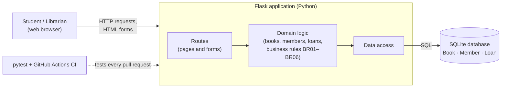
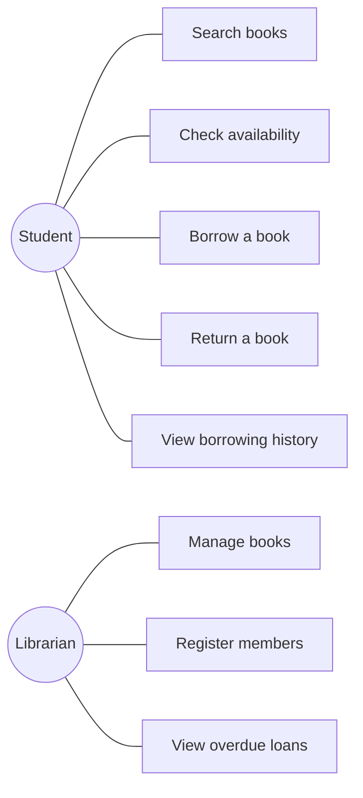
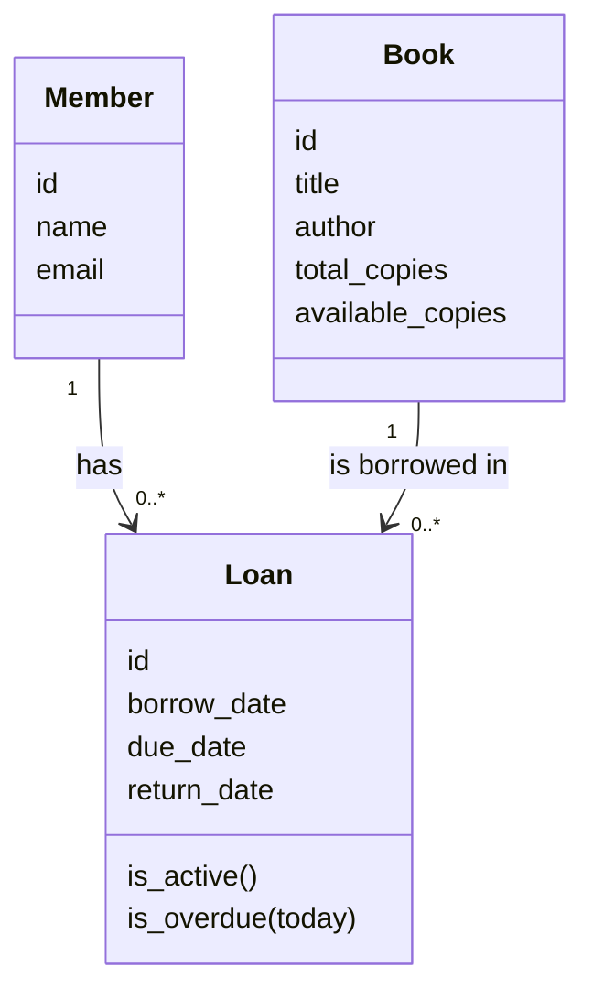

# Architecture

## Sprint 0 sketch

A simple three-part web application. The diagrams render automatically on GitHub.

- **Frontend:** HTML pages rendered by Flask templates, with CSS and a little JavaScript.
- **Backend:** Flask routes call the domain logic. Business rules live in the domain logic, not in the routes, so they can be unit-tested without a browser.
- **Database:** SQLite file. Each table has a unique ID.
- **Quality:** pytest for unit and route tests; GitHub Actions runs them on every pull request.

No REST API, microservices or extra patterns are planned: the product is a single small web app and does not need them.

## Use-case view

## Initial domain model

## Architecture decision records

### ADR-001: Flask + SQLite monolith (Sprint 0)

- **Context:** small team, short timeline, some members are new to web development.
- **Options:** (a) Flask + SQLite single app; (b) separate frontend framework (React) + REST API backend.
- **Decision:** (a) Flask + SQLite.
- **Consequences:** + one language (Python), fast setup, no server needed for the database, easy to test with pytest. − Less suitable for many simultaneous users; acceptable for the semester scope.

*(Sprint 2 adds an ADR based on a quality scenario.)*
